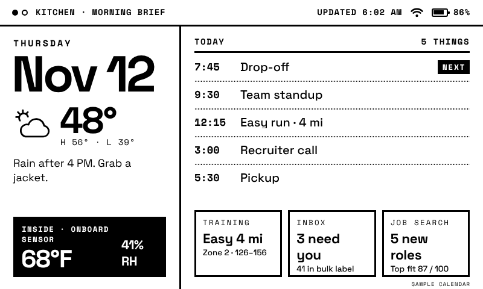

# reTerminal E1001 screens

Screens for a Seeed reTerminal E1001 running TRMNL firmware, served by
[LaraPaper](https://github.com/usetrmnl/larapaper) on a Raspberry Pi: two calendar
screens (Morning Brief and This Week), plus a Polestar status screen (see [`polestar/`](polestar/README.md)) and a
home energy screen for Dominion Energy (see [`dominion/`](dominion/README.md)).

| Time | Screen |
| --- | --- |
| 6:00–9:00 AM | **Morning brief**: date, weather, today's events, three tiles |
| 9:00 AM–10:00 PM | **This week**: yesterday, today and the next three days, a holiday countdown, reminders |
| 10:00 PM–6:00 AM | Sleep, with no refreshes, to save battery |

| Morning brief | This week |
| --- | --- |
|  |  |

## How it fits together

- `kitchen-board/` is a small Python service. It pulls weather from
  [Open-Meteo](https://open-meteo.com/) (no API key), reads calendars from
  private iCal links, and reads tiles and reminders from `content/content.yml`.
  It renders the HTML for both screens and serves it as JSON at `/api/brief`
  and `/api/week`.
- `larapaper/docker-compose.yml` runs LaraPaper, the calendar screens, the
  Polestar bridge and the Dominion bridge together.
- `polestar/` holds the Polestar status screen: a small bridge service that
  reads both cars from Polestar, and its LaraPaper recipe. Setup is in
  [`polestar/README.md`](polestar/README.md).
- `dominion/` holds the home energy screen: a small bridge that reads your
  Dominion Energy smart-meter data, and its LaraPaper recipe. Setup is in
  [`dominion/README.md`](dominion/README.md).
- In LaraPaper, one recipe per screen polls that JSON. The markup in
  `recipes/kitchen-board.liquid` fills in battery, Wi-Fi and onboard-sensor
  values. LaraPaper's playlists and sleep mode handle the schedule.

## First-time setup on the Pi

1. **Move LaraPaper into this repo.** The compose project is still named
   `larapaper`, so your existing data volumes are reused.

   ```bash
   cd ~/larapaper && docker compose down          # stops LaraPaper; volumes stay
   cd ~ && git clone https://github.com/simsjs/reterminal-e1001.git
   cd ~/reterminal-e1001/larapaper
   cp .env.example .env
   nano .env        # APP_KEY from ~/larapaper/docker-compose.yml, and APP_URL
   docker compose up -d --build
   docker volume ls | grep larapaper    # larapaper_database and larapaper_storage
   ```

   Log in to LaraPaper. Your account and the E1001 should still be there.

2. **Check the previews** in a browser at `http://<pi-ip>:4568/brief` and
   `http://<pi-ip>:4568/week`.

3. **Set up LaraPaper.**
   - Set your profile timezone to **America/New_York**. Playlists and sleep
     mode use it.
   - Create two recipes:

     | Name | Polling URL |
     | --- | --- |
     | Morning Brief | `http://kitchen-board:8080/api/brief` |
     | This Week | `http://kitchen-board:8080/api/week` |

     For both, use the **Polling** data strategy and the **Liquid** markup
     language. Paste `kitchen-board/recipes/kitchen-board.liquid` as the
     full-screen markup and refresh every 15 minutes. Turn on "no screen
     padding" if that option appears.
   - On the E1001's device page, add two playlists:
     - **Morning**: active 06:00–09:00, containing Morning Brief.
     - **Day**: active 09:00–22:00, containing This Week.
   - Turn on **sleep mode** from 22:00 to 06:00.
   - Set the refresh rate to **900 seconds** (15 minutes).

## Connecting calendars

Put private iCal links in `larapaper/.env`, comma-separated, then run
`docker compose up -d`:

- `CALENDAR_ICS_URLS` feed both screens. For Google Calendar, use Settings →
  your calendar → *Secret address in iCal format*.
- `BRIEF_ONLY_ICS_URLS` only show on the morning brief, which suits a work
  calendar.

Until a link is set, both screens show a sample week, marked
**SAMPLE CALENDAR** in the bottom-right corner.

## Tiles, reminders and countdowns

The Morning Brief tiles, the This Week reminders and the countdowns are
hand-written lists, not pulled from any app. Edit `kitchen-board/content/content.yml`. After a `git pull`, changes show up
on the next refresh without a rebuild.

## Updating

```bash
cd ~/reterminal-e1001 && git pull
cd larapaper && docker compose up -d --build
```

## Notes and troubleshooting

- **Inside temperature and humidity** come from the E1001's onboard sensor,
  but only if the TRMNL firmware reports those readings to LaraPaper.
  Otherwise the box shows `--`.
- **The recipe says the data isn't available, but the preview works:** check
  the polling URL. If LaraPaper won't fetch from the container name, use
  `http://<pi-ip>:4568/api/brief` and `/api/week` instead.
- **HTML tags show up as text:** switch the recipe's markup language to Blade
  and paste `recipes/kitchen-board.blade.php` instead.
- **Fonts look generic:** LaraPaper's renderer can't reach the fonts. Set
  `FONT_BASE_URL=http://<pi-ip>:4568` in `.env` and run `docker compose up -d`.
- **Run it on a laptop:**

  ```bash
  cd kitchen-board/app
  pip install -r ../requirements.txt
  SAMPLE_DATA=on FONT_BASE_URL=http://localhost:8080 NOW=2026-11-12T06:02 python server.py
  ```

Space Grotesk and Space Mono are licensed under the SIL Open Font License 1.1
(see `kitchen-board/app/fonts/`).
