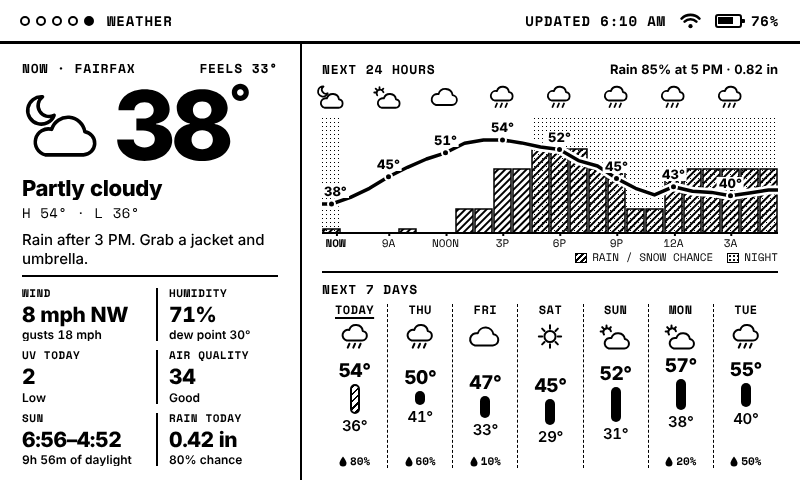

# reTerminal E1001 screens

A set of glanceable, black-and-white screens for a [Seeed reTerminal E1001](https://www.seeedstudio.com/) e-paper display, running TRMNL firmware and served by [LaraPaper](https://github.com/usetrmnl/larapaper) on a Raspberry Pi at home. It is a personal project: the display cycles through the screens every 15 minutes and sleeps overnight to save battery.

**[More information: first-time setup and full reference →](docs/SETUP.md)**

## Screens

| Dot | Screen | What it shows |
| --- | --- | --- |
| 1 | **This Week** | Yesterday, today and the next three days from a calendar, a holiday countdown and reminders from Google Tasks |
| 2 | **Polestar** | Charge, range and charging status of both cars |
| 3 | **Home energy** | This billing cycle's use and cost, yesterday's half-hour readings and the last 7 days |
| 4 | **Fitness** | The latest Strava activity and hours per week |
| 5 | **Weather** | Now, the next 5 days, wind, humidity, UV, air quality and sunrise |
| 6 | **Premier League** | The next matchweek's games, live and full-time scores, and the table |

Each screen has its own folder with a short README: [`polestar/`](polestar/README.md), [`dominion/`](dominion/README.md), [`strava/`](strava/README.md), [`weather/`](weather/README.md) and [`football/`](football/README.md). This Week lives in [`kitchen-board/`](kitchen-board/).

## Previews

The images below are 800 × 480 renders of the screens. This Week shows sample data.

| This Week | Weather |
| --- | --- |
|  |  |

| Home energy | Fitness |
| --- | --- |
|  |  |

## Privacy

The one part of this project that uses Google sign-in (OAuth) reads your Google Tasks, read-only, for the reminders on This Week. See the [privacy policy](PRIVACY.md).

## License

Space Grotesk and Space Mono are licensed under the SIL Open Font License 1.1 (see `kitchen-board/app/fonts/`).
