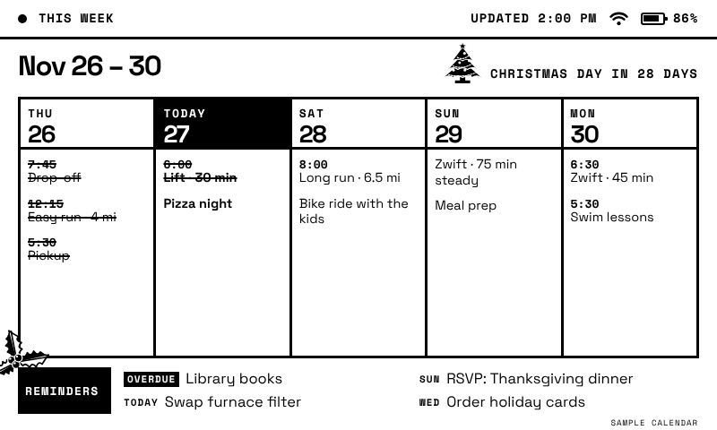

# reTerminal E1001 screens

Screens for a Seeed reTerminal E1001 running TRMNL firmware, served by
[LaraPaper](https://github.com/usetrmnl/larapaper) on a Raspberry Pi: a calendar
screen (This Week), a Polestar status screen (see [`polestar/`](polestar/README.md)), a
home energy screen for Dominion Energy (see [`dominion/`](dominion/README.md)), a
fitness screen from Strava (see [`strava/`](strava/README.md)) and a weather screen
(see [`weather/`](weather/README.md)).

| Time | Screen |
| --- | --- |
| 6:00 AM–10:00 PM | **This week**: yesterday, today and the next three days, a holiday countdown, reminders |
| 10:00 PM–6:00 AM | Sleep, with no refreshes, to save battery |



## How it fits together

- `kitchen-board/` is a small Python service for the This Week screen. It
  reads calendars from private iCal links, holidays from Google's public US
  holiday calendar, reminders from Google Tasks, and personal countdowns from
  `content/content.yml`. It renders the screen's HTML and serves it as JSON at
  `/api/week`. It also serves the header fonts for every screen.
- `larapaper/docker-compose.yml` runs LaraPaper, the calendar screen, the
  `bridges` service and (until it moves into it) the Dominion bridge together.
- `bridges/` is one Python service for the screens that need outside data. Each
  screen is its own module there (so far `weather.py`, `strava.py` and `polestar.py`) with its own routes,
  token and refresh loop; one screen failing doesn't stop the others.
  `http://localhost:4572/health` shows each screen's status. LaraPaper still
  reaches each screen by its old name (`weather-bridge`, ...).
- `polestar/` holds the Polestar status screen's LaraPaper recipe and pictures.
  Its data (both cars, read from Polestar) comes from `bridges/polestar.py`. Setup is in
  [`polestar/README.md`](polestar/README.md).
- `dominion/` holds the home energy screen: a small bridge that reads your
  Dominion Energy smart-meter data, and its LaraPaper recipe. Setup is in
  [`dominion/README.md`](dominion/README.md).
- `strava/` holds the fitness screen's LaraPaper recipe and sign-in tool. Its
  data (your activities from the Strava API) comes from `bridges/strava.py`. Setup is in
  [`strava/README.md`](strava/README.md).
- `weather/` holds the weather screen's LaraPaper recipe and pictures. Its data
  (forecast from Open-Meteo, air quality, and National Weather Service alerts)
  comes from `bridges/weather.py`. Setup is in [`weather/README.md`](weather/README.md).
- In LaraPaper, one recipe per screen polls that JSON. The markup in
  `recipes/kitchen-board.liquid` fills in battery, Wi-Fi and onboard-sensor
  values. LaraPaper's playlists and sleep mode handle the schedule.

## First-time setup on the Pi

1. **Move LaraPaper into this repo.** The compose project is still named
   `larapaper`, so your existing data volumes are reused.

   ```bash
   cd ~/larapaper && docker compose down          # stops LaraPaper; volumes stay
   cd ~ && git clone https://github.com/simsjs/reterminal-e1001.git
   cd ~/reterminal-e1001/larapaper
   cp .env.example .env
   nano .env        # APP_KEY from ~/larapaper/docker-compose.yml, and APP_URL
   docker compose up -d --build
   docker volume ls | grep larapaper    # larapaper_database and larapaper_storage
   ```

   Log in to LaraPaper. Your account and the E1001 should still be there.

2. **Check the preview** at `http://localhost:4568/week` (see "Previews and raw data" below for how to
   open them from your laptop).

3. **Set up LaraPaper.**
   - Set your profile timezone to **America/New_York**. Playlists and sleep
     mode use it.
   - Create a recipe called **This Week** with the polling URL
     `http://kitchen-board:8080/api/week`. Use the **Polling** data strategy and the **Liquid** markup
     language. Paste `kitchen-board/recipes/kitchen-board.liquid` as the
     full-screen markup and refresh every 15 minutes. Turn on "no screen
     padding" if that option appears.
   - On the E1001's device page, add a **Day** playlist, active 06:00–22:00,
     containing This Week.
   - Turn on **sleep mode** from 22:00 to 06:00.
   - Set the refresh rate to **900 seconds** (15 minutes).

## Connecting calendars

Put private iCal links in `larapaper/.env`, comma-separated, then run
`docker compose up -d`:

- `CALENDAR_ICS_URLS` feed This Week. For Google Calendar, use Settings →
  your calendar → *Secret address in iCal format*.

Until a link is set, This Week shows a sample week, marked
**SAMPLE CALENDAR** in the bottom-right corner.

## Reminders from Google Tasks

The reminders strip on This Week shows your open Google Tasks (the "Tasks"
entry in Google Calendar's sidebar) that are overdue or due in the next 7 days,
soonest first, each with a day label: OVERDUE, TODAY, TMRW or the weekday.
Tick a task off on your phone and it drops off within about 10 minutes.

Google Tasks isn't a real calendar and has no iCal link, so the Pi reads it
through the Google Tasks API. That needs a one-time setup:

1. **Make a Google Cloud project.** Go to
   [console.cloud.google.com](https://console.cloud.google.com), create a
   project (any name, e.g. *E1001*), then open *APIs & Services → Library*,
   search for **Google Tasks API** and click **Enable**.
2. **Set up the consent screen.** In *APIs & Services → OAuth consent screen*
   (called *Google Auth Platform* in newer consoles), choose **External**, fill
   in the app name and your email, and add yourself as a test user. Then go to
   *Audience* (or *Publishing status*) and click **Publish app** so it's
   **In production**. Skip this and Google cancels the sign-in every 7 days.
   You don't need to submit it for verification.
3. **Make a client.** In *Credentials* (or *Clients*), create an **OAuth
   client ID** of type **Desktop app**. Copy the client ID and client secret.
4. **Sign in once, on your laptop:**

   ```bash
   python3 kitchen-board/tools/get_tasks_token.py CLIENT_ID CLIENT_SECRET
   ```

   No Python on your laptop? SSH into the Pi as usual and run the same command
   there. Open the link it prints in your laptop's browser and allow access.
   The browser then shows an error page ("This site can't be reached"); copy
   that page's whole address and paste it into the terminal.

   Sign in with the account that has your Tasks. Google warns that it hasn't
   verified the app, because it's your own. Click *Advanced → Go to E1001*,
   then allow read-only access to Tasks. The script prints three lines.
5. **Paste those three lines into `larapaper/.env` on the Pi**, then run
   `docker compose up -d`.

Optional settings in `.env`: `TASKS_LISTS` limits which task lists are shown
(by name), `TASKS_DAYS_AHEAD` changes the 7-day window, and
`TASKS_INCLUDE_UNDATED=on` adds tasks with no due date. Until Google Tasks is
set up, the strip shows the `reminders:` list in `content.yml`.

## Holiday countdown

The countdown at the top right of This Week shows the next holiday within 60
days from Google's public **Holidays in United States** calendar, so it never
needs updating. You can add your own dates (birthdays, trips) to `countdowns:`
in `content.yml`; whichever is sooner is shown. `HOLIDAY_SHOW_WITHIN_DAYS` in
`.env` changes the 60-day window.

## Page dots

The dots at the top left of every screen come from one setting in
`larapaper/.env`, listing the screens in playlist order:

```
SCREEN_ORDER=week,polestar,energy,fitness,weather
```

Each service works out its own dot and the total from it. After adding,
removing or reordering a screen, change this line and run
`docker compose up -d`; the dots follow on each screen's next refresh. The
recipes' **Page dot** and **Total pages** settings are only a fallback.

The header itself (dots, title, Wi-Fi and battery) is drawn from one file,
`shared/header.css`, with the recipe part in `shared/header.liquid`. After
changing either, run `tools/build-recipes.sh`. It copies them into the four
recipes and the calendar service and rebuilds the recipe zips; then import the
zips in LaraPaper again and rebuild the calendar service.

## Previews and raw data

Only LaraPaper (port 4567) is open to your home network. The previews and the
bridges' raw-data pages (ports 4568-4572) answer on the Pi itself. To open them
in a browser on your laptop, tunnel them over SSH and leave that window open:

```bash
ssh -L 4568:localhost:4568 -L 4569:localhost:4569 -L 4570:localhost:4570 \
    -L 4571:localhost:4571 -L 4572:localhost:4572 pi@<pi-ip>
```

Then use `http://localhost:4568/week` and so on. To open the ports to the whole
network again, set `LOCAL_BIND=0.0.0.0` in `larapaper/.env` and run
`docker compose up -d`.

## Updating

```bash
cd ~/reterminal-e1001 && git pull
cd larapaper && docker compose up -d --build
```

## Notes and troubleshooting

- **The recipe says the data isn't available, but the preview works:** check
  the polling URL. If LaraPaper won't fetch from the container name, set
  `LOCAL_BIND=0.0.0.0` in `.env`, run `docker compose up -d`, and use
  `http://<pi-ip>:4568/api/week` instead.
- **HTML tags show up as text:** switch the recipe's markup language to Blade
  and paste `recipes/kitchen-board.blade.php` instead.
- **Fonts look generic:** LaraPaper's renderer can't reach the fonts. Set
  `FONT_BASE_URL=http://<pi-ip>:4568` and `LOCAL_BIND=0.0.0.0` in `.env` and run
  `docker compose up -d`.
- **Run it on a laptop:**

  ```bash
  cd kitchen-board/app
  pip install -r ../requirements.txt
  SAMPLE_DATA=on FONT_BASE_URL=http://localhost:8080 NOW=2026-11-12T06:02 python server.py
  ```

Space Grotesk and Space Mono are licensed under the SIL Open Font License 1.1
(see `kitchen-board/app/fonts/`).
