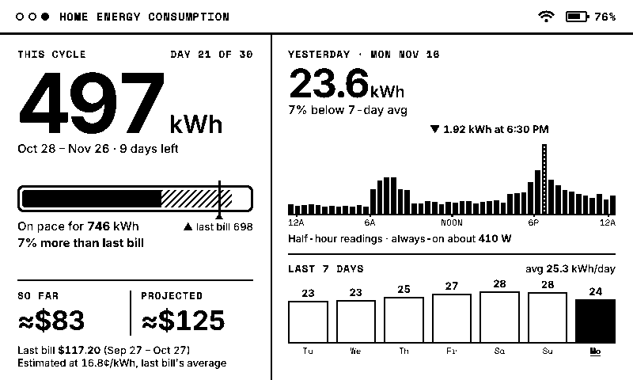

# Home energy screen (Dominion Energy)

A full-screen LaraPaper recipe for the E1001 showing your Dominion Energy Virginia electricity use. It has the same header row as the other screens: page dots, **HOME ENERGY CONSUMPTION**, Wi-Fi and battery.



- **Left, this billing cycle:** kWh used so far, which day of the cycle it is, and a bar. In the bar, solid black is usage so far, stripes are the rest of the projected month, and the ▲ tick is last bill's kWh. Under the bar is the projected total and how it compares with last bill. Below that, in dollars, are the cost so far and the projected bill.
- **Right, usage detail:** the latest full day (usually yesterday) with its 48 half-hour readings and the peak marked, the always-on draw, and the last 7 days. Your logo, if you add one, sits in the top-right corner (the preview is shown without it).

## How it works

Dominion has no public API, so the home energy screen is one part of the `bridges` service (`bridges/dominion.py`; `bridges` in `larapaper/docker-compose.yml`, which LaraPaper still reaches as `dominion-bridge`). It uses the community library [dompower](https://github.com/YeomansIII/dompower), the one behind the Home Assistant integration, to read two things:

- the current billing cycle from Dominion's bill-forecast endpoint: dates, kWh so far, and last bill's dollars and kWh
- 30-minute smart-meter readings for the last 9 days

It checks every 2 hours and serves the result to LaraPaper as JSON. It only reads and never changes anything on your account.

**The dollar figures are estimates.** Dominion doesn't send a cost forecast, so the bridge multiplies kWh by last bill's average rate (total ÷ kWh). That rate includes fixed charges and riders, so the estimate is close but not exact.

**The data runs about a day behind.** Smart-meter readings usually show up the next day, so the right side shows the latest full day and labels it with its date. If the newest data is more than two days old, a **Data delayed** tag appears.

## Setup on the Pi

1. **Pull and add the token to `.env`.**

   ```bash
   cd ~/reterminal-e1001 && git pull
   cd larapaper
   nano .env   # add the "Home energy screen" block from .env.example
   ```

   - `DOMINION_BRIDGE_TOKEN`: make one with `python3 -c "import secrets; print(secrets.token_urlsafe(24))"`.
   - Check that `SCREEN_ORDER` lists `energy` where you want its dot (see *Page dots* in the main README).
   - For a first look without logging in, set `DOMINION_DEMO=1`.

   Put the Dominion logo at `dominion/images/logo.png`. It stays on the Pi and out of git; see [`images/README.md`](images/README.md).

2. **Start it, then log in to Dominion once.** Have your phone ready: Dominion texts or emails a code, and it expires after about 5 minutes.

   ```bash
   docker compose up -d --build bridges
   docker compose exec bridges dompower login -u you@example.com -o /data/dominion/tokens.json --cookies /data/dominion/cookies.json
   docker compose exec bridges dompower --token-file /data/dominion/tokens.json select-account
   docker compose restart bridges
   ```

   The tokens and login cookies go into the `larapaper_dominion` Docker volume (at `/data/dominion` in the `bridges` service), so they survive rebuilds. The cookies let later logins skip the code.

3. **Check it.**

   ```bash
   docker compose logs -f bridges   # look for "energy: Refreshed: ... kWh this cycle"
   ```

4. **Import the recipe in LaraPaper.** Go to Plugins → Add Recipe → Import Recipe Archive and upload `dominion/dominion-recipe.zip` (download it from GitHub). Then open its settings:
   - **Bridge URL:** `http://dominion-bridge:8765`
   - **Bridge token:** the same value as `DOMINION_BRIDGE_TOKEN`
   - **Page dot / Total pages:** leave the defaults. The bridge sends the real values, worked out from `SCREEN_ORDER`.

5. **Add it to a playlist.** On the E1001's device page, add *Home Energy Consumption* to the **Day** playlist with the other screens.

## Extras

- **Raw panel data:** `http://localhost:4570/dominion.json?token=<DOMINION_BRIDGE_TOKEN>`
- **Dominion's raw bill-forecast response** (to see every field they send): `http://localhost:4570/raw.json?token=<DOMINION_BRIDGE_TOKEN>`
- **Status:** `http://localhost:4570/health`

## Settings (`larapaper/.env`)

| Variable | Default | |
| --- | --- | --- |
| `DOMINION_REFRESH_MINUTES` | 120 | How often the bridge checks Dominion (minimum 30) |
| `DOMINION_ACCOUNT` / `DOMINION_METER` | from `select-account` | Pin a specific account and meter |
| `DOMINION_DEMO` | 0 | `1` shows sample data |

The logo is `images/logo.png`, kept on the Pi and ignored by git. Any black-on-white or colored PNG works: the bridge trims it and converts it to solid black and white at 54 px tall (set `DOMINION_LOGO_HEIGHT` on the `bridges` service to change that). After changing it, run `docker compose restart bridges`.

## When it stops working

- **"Refresh token expired" or another auth error:** Dominion's login has lapsed. Its refresh token dies about 90 minutes after it was last used, so the bridge renews it every 20 minutes (`DOMINION_KEEPALIVE_MINUTES`; look for "Saved refreshed Dominion tokens" in `docker compose logs bridges`). It can still lapse if the bridges service or the Pi is off for more than about an hour. Run the `dompower login` command from step 2 again, then `docker compose restart bridges`.
- **dompower is unofficial.** If Dominion changes its website, the screen keeps the last good data and shows **Offline**. When a fix is released, bump the version in `bridges/requirements.txt` and rebuild.
