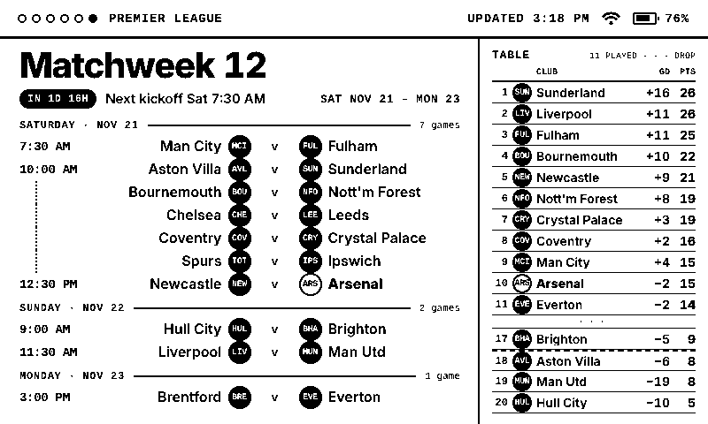
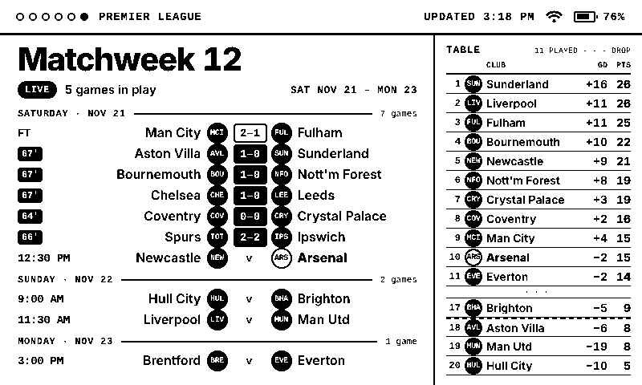

# Premier League screen

A full-screen LaraPaper recipe for the E1001 built around the next Premier League matchweek. It has the same header row as the other screens: page dots, **PREMIER LEAGUE**, the update time, Wi-Fi and battery.



**Left, the matchweek.** **Matchweek 12** (or whichever is next) as the title, then a countdown to the next kickoff and the dates the matchweek covers. Under that, every game grouped by day with its kickoff time in Eastern time. When several games kick off together, the time is printed once and a dotted line runs down the rest of them.

**Right, the table.** As many rows as fit: the bottom 4 always, then the table from 1st down (1st–11th by default), with **···** where teams are skipped. Each row has goal difference and points, and a dashed line marks the relegation places. The table is worked out from every finished game this season (points, then goal difference, then goals scored).

**Crests.** Each club shows a plain round badge with its 3-letter code, unless you've put a picture of its crest in `football/images/` on the Pi. The bridge turns those into black and white at the right size. A `lion_w_text.png` or `lion.png` there puts the league logo in front of the **Matchweek** title. See [`images/README.md`](images/README.md).

| While games are on |
| --- |
|  |

While the matchweek is under way, games in play show the minute and the live score (in black), finished games show **FT** and the final score, and the line under the title says how many games are in play. Once every game in the matchweek has finished, the screen moves on to the next one. Scores and the table update every 15 minutes, like the rest of the display.

The previews use made-up data.

## How it works

The screen is one part of the `bridges` service (`bridges/football.py`, which LaraPaper reaches as `football-bridge`). Every 15 minutes it reads the fixtures and results from the [Fantasy Premier League](https://fantasy.premierleague.com/) feed, which is free and needs no account or key, and turns them into ready-to-draw JSON. If the feed can't be reached, the screen keeps the last good data and shows an **Offline** tag in place of the countdown.

## Setup on the Pi

1. **Pull and update `.env`.**

   ```bash
   cd ~/reterminal-e1001 && git pull
   cd larapaper
   nano .env   # add the "Premier League screen" block from .env.example
   ```

   - Add `football` to `SCREEN_ORDER` where you want its dot, e.g. `SCREEN_ORDER=week,polestar,energy,fitness,weather,football`.
   - `FOOTBALL_FAVORITE` is optional: a club's 3-letter code (`ARS`, `LIV`, `MCI`…) prints its name in bold and gives it an outlined badge.
   - `FOOTBALL_BRIDGE_TOKEN` is optional. Fixtures aren't private, so you can leave it empty.

2. **Restart the services.**

   ```bash
   docker compose up -d --build
   docker compose logs -f bridges   # look for "football: Refreshed: matchweek ..."
   ```

3. **Import the recipe in LaraPaper.** Go to Plugins → Add Recipe → Import Recipe Archive and upload `football/football-recipe.zip` (download it from GitHub). In its settings, the **Bridge URL** is `http://football-bridge:8765`; leave the rest as they are.

4. **Add it to a playlist.** On the E1001's device page, add *Premier League* to the **Day** playlist with the other screens.

## Extras

- **Raw panel data:** `http://localhost:4573/football.json`
- **Demo:** set `FOOTBALL_DEMO=1` and run `docker compose up -d` to see a made-up matchweek dated this weekend.

## Settings (`larapaper/.env`)

| Variable | Default | |
| --- | --- | --- |
| `FOOTBALL_FAVORITE` | (none) | Your club's 3-letter code, shown in bold |
| `FOOTBALL_TABLE_ROWS` | 15 | Table rows: the bottom 4 always, the rest from 1st down |
| `FOOTBALL_CREST_THRESHOLD` | 150 | Crest pictures: colors darker than this (0–255) turn black |
| `FOOTBALL_REFRESH_MINUTES` | 15 | How often the bridge checks for fixtures and scores (minimum 5) |
| `FOOTBALL_BRIDGE_TOKEN` | (none) | Token LaraPaper must send |
| `FOOTBALL_DEMO` | 0 | `1` shows made-up data |
