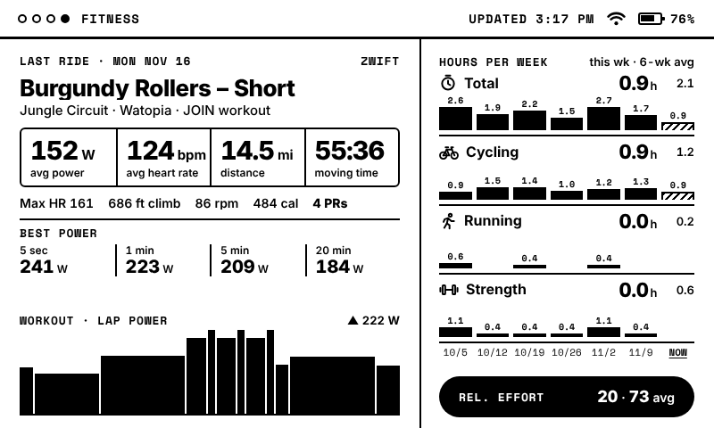
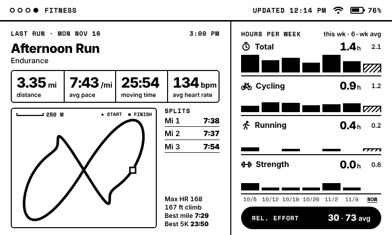
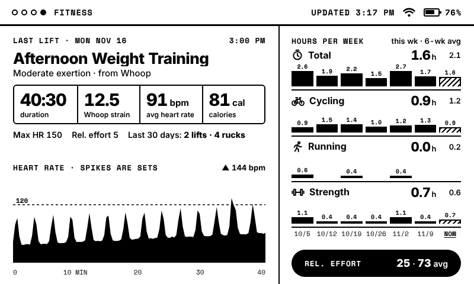

# Fitness screen (Strava)

A full-screen LaraPaper recipe for the E1001 showing your training from Strava. It has the same header row as the other screens: page dots, **FITNESS**, the update time, Wi-Fi and battery.



**Left, your latest activity.** The layout depends on what it was:

- **A ride** (Zwift or outside): average power, heart rate, distance and moving time; max heart rate, climb, cadence, calories and PRs; best power for 5 seconds, 1, 5 and 20 minutes; and a chart of each lap's average power. A free ride with no workout laps shows a heart-rate chart instead, with a white dotted line at the ride's average heart rate.
- **A run** (or a walk, hike or ruck with GPS): distance, pace, time and heart rate, a map of the route with start and finish marked, mile splits, and best mile and 5K.
- **Anything else**, like a lifting session or a Whoop workout: duration, Whoop strain, heart rate and calories, icons for your last five rides, runs and strength sessions (newest on the left), and a heart-rate chart where each spike is a set.

| After a run | After a strength session |
| --- | --- |
|  |  |

The previews use made-up data. The route in the run preview is a drawn shape, not a real place.

**Right, hours per week.** Total, cycling, running and strength, each with this week's hours, the average of the last 6 full weeks, and a bar per week (this week is striped). Strength counts lifting and rucking together. The black pill at the bottom is this week's relative effort, then the 6-week average.

## How it works

The fitness screen is one part of the `bridges` service (`bridges/strava.py`; `bridges` in `larapaper/docker-compose.yml`, which LaraPaper still reaches as `strava-bridge`). Every 15 minutes it asks the official Strava API for the last 7 weeks of activities. When there's a new latest activity, it also fetches that one's details, laps and heart-rate and power data. It turns all that into ready-to-draw JSON for LaraPaper. It only reads and never changes anything on your Strava account.

What counts as what:

- **Cycling:** any ride, including Zwift (`VirtualRide`).
- **Running:** runs, trail runs and treadmill runs.
- **Strength:** `WeightTraining`, `Workout`, `Crossfit` and `HIIT`, plus anything with "ruck" in its title. Change these with `STRAVA_STRENGTH_TYPES` and `STRAVA_RUCK_WORDS` in `.env`.
- **Total** includes everything, such as walks and swims.

Hours are moving time. Relative effort is Strava's own score, so it only shows if Strava calculates it for your activities (it needs heart rate and a Strava subscription).

**Strava doesn't share strength sets.** Its API has no way to read the exercises, weights and reps in a workout log, so the strength layout uses duration, heart rate and Whoop's strain instead. Whoop's strain comes from the note Whoop adds to each activity's description.

## Setup on the Pi

1. **Make a Strava API app.** Go to [strava.com/settings/api](https://www.strava.com/settings/api) and create an app. Any name and website work (e.g. *E1001* and `http://localhost`). Set **Authorization Callback Domain** to `localhost`. Copy the **Client ID** and **Client Secret**.

2. **Sign in once.** On your laptop or over SSH on the Pi:

   ```bash
   cd ~/reterminal-e1001 && git pull
   python3 strava/tools/get_strava_token.py CLIENT_ID CLIENT_SECRET
   ```

   Open the link it prints, check that the box for activities is ticked, and click **Authorize**. The browser then shows an error page ("This site can't be reached"); copy that page's whole address and paste it into the terminal. The script prints three lines.

3. **Add them to `.env`.**

   ```bash
   cd ~/reterminal-e1001/larapaper
   nano .env   # add the "Fitness screen" block from .env.example
   ```

   - Paste the three `STRAVA_` lines from step 2.
   - `STRAVA_BRIDGE_TOKEN`: make one with `python3 -c "import secrets; print(secrets.token_urlsafe(24))"`.
   - Check that `SCREEN_ORDER` lists `fitness` where you want its dot (see *Page dots* in the main README).
   - For a first look without signing in, set `STRAVA_DEMO=1`.

4. **Start it.**

   ```bash
   docker compose up -d --build
   docker compose logs -f bridges   # look for "fitness: Refreshed: ... activities"
   ```

5. **Import the recipe in LaraPaper.** Go to Plugins → Add Recipe → Import Recipe Archive and upload `strava/strava-recipe.zip` (download it from GitHub). Then open its settings:
   - **Bridge URL:** `http://strava-bridge:8765`
   - **Bridge token:** the same value as `STRAVA_BRIDGE_TOKEN`
   - **Page dot / Total pages:** leave the defaults. The bridge sends the real values, worked out from `SCREEN_ORDER`.

6. **Add it to a playlist.** On the E1001's device page, add *Fitness* to the **Day** playlist with the other screens.

## Extras

- **Raw panel data:** `http://localhost:4571/fitness.json?token=<STRAVA_BRIDGE_TOKEN>`
- **Status:** `http://localhost:4571/health`
- **Try each layout in demo mode:** set `STRAVA_DEMO=1` and `STRAVA_DEMO_LAYOUT` to `ride`, `route` or `effort`, then run `docker compose up -d`.

## Settings (`larapaper/.env`)

| Variable | Default | |
| --- | --- | --- |
| `STRAVA_REFRESH_MINUTES` | 15 | How often the bridge checks Strava (minimum 5) |
| `STRAVA_STRENGTH_TYPES` | `WeightTraining,Workout,Crossfit,HIIT` | Strava sport types counted as strength |
| `STRAVA_RUCK_WORDS` | `ruck` | Words in a title that make an activity a ruck (counted as strength) |
| `STRAVA_DEMO` | 0 | `1` shows made-up data |

## When it stops working

- **"No Strava data yet" with a sign-in error:** the Strava access was removed (for example under *My Apps* in Strava's settings). Run step 2 again, put the new `STRAVA_REFRESH_TOKEN` in `.env`, then run `docker compose up -d`.
- **Offline tag in the corner:** the bridge couldn't reach Strava on its last try and is showing the last good data. It tries again every 15 minutes.
- Strava limits how often apps can ask for data. The bridge uses about 100 requests a day, well under the limit.
