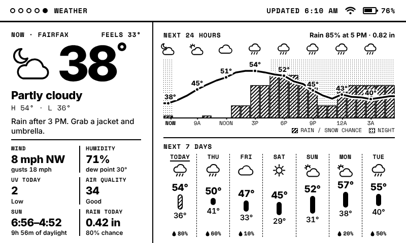
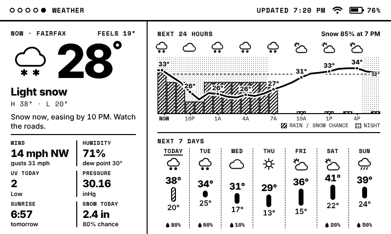

# Weather screen

A full-screen LaraPaper recipe for the E1001 showing the weather in Fairfax. It has the same header row as the other screens: page dots, **WEATHER**, the update time, Wi-Fi and battery.



**Left, right now.** The current temperature with an icon (a moon at night), what it feels like, the conditions, and today's high and low. Under that is a short plan for the next 12 hours, like *Rain 3–9 PM. Grab a jacket and umbrella.* If the National Weather Service has a watch, warning or advisory out for your area, a black box with the alert and its times replaces the plan. At the bottom are six details:

- **Wind:** speed and direction, with gusts when they're well above the wind
- **Humidity:** with the dew point
- **UV today:** the day's peak and its level (Low to Extreme)
- **Air quality:** the US AQI and its level (Good, Moderate…). If air quality can't be fetched, this shows the pressure instead.
- **Sun:** sunrise and sunset and hours of daylight. After sunset it shows tomorrow's sunrise.
- **Rain today** (or **Snow today** when snow is expected): the day's total and the chance

**Right, the next 24 hours.** The temperature as a line with a reading and an icon every 3 hours, and the chance of rain or snow as striped bars. Dotted shading marks the night. A dashed line marks 32° when the temperature crosses freezing. The top-right note gives the highest chance, when it is, and how much is expected (snowfall for snow).

**Below, the next 7 days.** Each day has its icon, high, low and chance of rain or snow. The bar runs from the low to the high on the week's scale, so warm and cold days stand out. Today's bar is striped.

| A snowy evening |
| --- |
|  |

The previews use made-up data.

## Pictures of the house

Add drawings of the house for each season and kind of weather to `weather/images/` on the Pi, and the left side becomes that picture: snowing, snow on the ground, rain, windy, clear or cloudy, with leafy versions for spring and summer and a night picture for dry evenings. The current temperature, conditions, plan (or alert) and the six details sit underneath in three columns, and the 24-hour chart and 7-day forecast move into a narrower right side. The picture gives up some height when an alert or a two-line plan needs the room. It's cropped from the middle, never rescaled, so the dithering stays crisp.

The pictures stay on the Pi and out of git. File names and the rules for which one shows are in [`images/README.md`](images/README.md). Without any pictures, the screen uses the layout shown above.

## How it works

`bridge/` runs a small Python service (`weather-bridge` in `larapaper/docker-compose.yml`). Every 15 minutes it asks three free services that need no account or API key:

- [Open-Meteo](https://open-meteo.com/) for the current conditions and the hourly and daily forecast (the same source as the Morning Brief)
- Open-Meteo's air-quality API for the US AQI
- the National Weather Service's [alerts API](https://www.weather.gov/documentation/services-web-api) for active watches, warnings and advisories at your location

It turns all that into ready-to-draw JSON for LaraPaper, including the house picture for right now (converted to black and white once, and again only when the file changes). If Open-Meteo can't be reached, the screen keeps the last good forecast and shows an **Offline** tag where the feels-like reading usually is. If only air quality or alerts fail, the rest of the screen still updates.

## Setup on the Pi

1. **Pull and update `.env`.**

   ```bash
   cd ~/reterminal-e1001 && git pull
   cd larapaper
   nano .env   # add the "Weather screen" block from .env.example
   ```

   - The location comes from `WEATHER_LAT` and `WEATHER_LON`, which are already in your `.env` for the calendar screens. `WEATHER_PLACE` is the name shown on the screen.
   - `WEATHER_BRIDGE_TOKEN` is optional. Weather isn't private, so you can leave it empty.
   - Set `KB_PAGE_COUNT=5` so This Week shows five dots.
   - For a first look without going online, set `WEATHER_DEMO=1`.
   - Optional: copy the house pictures into `~/reterminal-e1001/weather/images/` (see [`images/README.md`](images/README.md)).

2. **Start it.**

   ```bash
   docker compose up -d --build
   docker compose logs -f weather-bridge   # look for "Refreshed: 38°F, Partly cloudy"
   ```

3. **Import the recipe in LaraPaper.** Go to Plugins → Add Recipe → Import Recipe Archive and upload `weather/weather-recipe.zip` (download it from GitHub). Then open its settings:
   - **Bridge URL:** `http://weather-bridge:8765`
   - **Bridge token:** the same value as `WEATHER_BRIDGE_TOKEN`, or empty
   - **Page dot / Total pages:** 5 and 5 (the defaults)

4. **Add a fifth dot to the other screens.** Open the Polestar, Home Energy Consumption and Fitness recipes' settings and set **Total pages** to `5`.

5. **Add it to a playlist.** On the E1001's device page, add *Weather* to the **Day** playlist with the other screens.

## Extras

- **Raw panel data:** `http://<pi-ip>:4572/weather.json` (add `?token=<WEATHER_BRIDGE_TOKEN>` if you set one)
- **Status:** `http://<pi-ip>:4572/health`

## Settings (`larapaper/.env`)

| Variable | Default | |
| --- | --- | --- |
| `WEATHER_LAT` / `WEATHER_LON` | Fairfax, VA | Location, shared with the calendar screens |
| `WEATHER_PLACE` | Fairfax | Name shown on the screen |
| `WEATHER_REFRESH_MINUTES` | 15 | How often the bridge checks the forecast (minimum 5) |
| `WEATHER_ALERTS` | on | `off` skips National Weather Service alerts |
| `WEATHER_SCENE` | auto | Pictures of the house: `auto` picks one for the season and weather, `off` never shows one, or a name like `rain` always shows that one |
| `WEATHER_DEMO` | 0 | `1` shows made-up data |

## When it stops working

- **"No weather data yet":** the bridge hasn't reached Open-Meteo since it started. Check that the Pi is online, then look at `docker compose logs weather-bridge`.
- **Offline tag in the corner:** the last refresh failed and the screen is showing the forecast from the time in the header. It tries again every 15 minutes.
- **No alert box during a storm you know about:** the National Weather Service only issues alerts for some hazards. Check `docker compose logs weather-bridge | grep NWS` for fetch errors.
